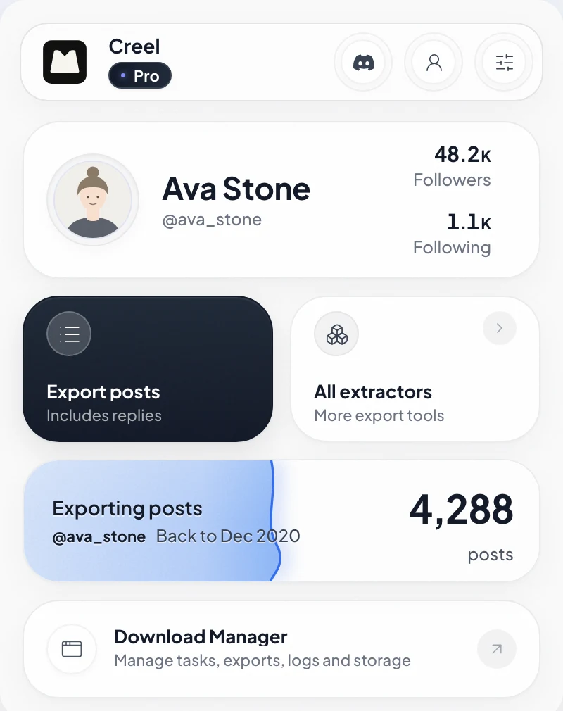
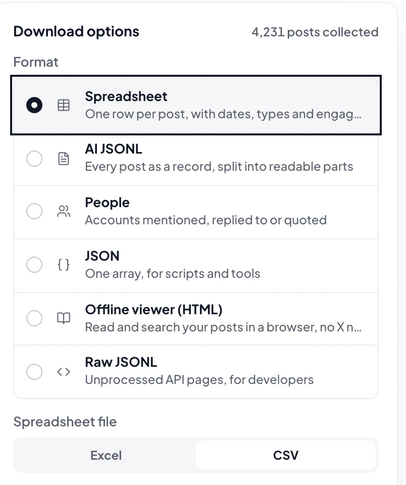

# Creel: export X (Twitter) bookmarks, followers, posts and likes to CSV, Excel and JSON

Creel is a Chrome extension that exports X (Twitter) bookmarks with their folders, your likes, an account's posts and replies, followers, following and list members to CSV, Excel and JSON files, in your own browser. It needs no X API key and no password, and it is free up to 1,000 records per export, with no Creel account. You only need to be signed in to X.

English | [简体中文](README.zh-CN.md)

This repository is Creel's public documentation and issue tracker. It holds what every export contains, sample files, the limits, and a place to report problems. Creel is closed source, so there is no source code here.



## Contents

- [Install](#install)
- [How to export each kind of X data](#how-to-export-each-kind-of-x-data)
- [What you can export](#what-you-can-export)
- [File formats](#file-formats)
- [Columns in every export](#columns-in-every-export)
- [How values are written](#how-values-are-written)
- [Sample files](#sample-files)
- [Free, Pro and Max](#free-pro-and-max)
- [What Creel does not do](#what-creel-does-not-do)
- [Privacy](#privacy)
- [Common questions](#common-questions)
- [Troubleshooting](#troubleshooting)
- [Report a problem or ask a question](#report-a-problem-or-ask-a-question)
- [Changelog](#changelog)

## Install

- **Chrome:** [Creel in the Chrome Web Store](https://chromewebstore.google.com/detail/beildllmkhjnebibpaenchhkoalacgkk?utm_source=github&utm_medium=readme&utm_campaign=creel-repo). Needs Chrome 120 or newer.
- **Microsoft Edge:** submitted to Edge Add-ons on 2026-11-19 and still in review on 2026-11-21. There is no Edge Add-ons link yet.
- **Website:** [ensoullab.com/extensions/creel](https://ensoullab.com/extensions/creel)

To use it, sign in to X in the same browser, open a profile, your bookmarks, a list, a search or a post, and click the Creel button in the toolbar. Creel shows the exports that fit the page, and the rest under All extractors. It collects in the background while Chrome is open. The Download Manager, a page of the extension, shows the progress and is where you save the files.

## How to export each kind of X data

Each answer below has a longer guide on the Creel website with every column and a sample file.

### How do I export my X (Twitter) bookmarks?

Open your bookmarks at x.com/i/bookmarks and click Creel. Choose all bookmarks or, if your account has folders, one folder. The file has one row per saved post: the text, the author, the date, the counts, links to images and video, and the folders the post is filed in. Save it as CSV, Excel or JSON. Free covers 1,000 bookmarks per export, and each folder is its own export. Creel reads only your own bookmarks. Bookmarks have no daily or weekly updates; on a finished export, Check for new bookmarks runs a fresh export on any plan, and with Max it also counts what is new and what was removed. Guide: [Export X (Twitter) bookmarks to CSV](https://ensoullab.com/extensions/creel/export-x-bookmarks).

### How do I export my X (Twitter) likes?

On any X page, click Creel, open All extractors and choose Likes under Your library. Likes are always those of the account signed in to your browser. The file has one row per liked post, with the same columns as bookmarks except the folders, as CSV, Excel, JSON or an offline viewer you can read without X. Likes have no Update or Auto update; for newer likes, choose Duplicate as new export in the export's menu in the Download Manager. Guide: [Export your X (Twitter) likes](https://ensoullab.com/extensions/creel/export-x-likes).

### How do I export the followers of an X (Twitter) account?

Open the profile, yours or any account you can see, click Creel, open All extractors and choose Followers under This profile. The file has one row per account: handle, name, bio, location, website, follower and following counts, the verification flags, and whether each account follows you. A protected account's list is out of reach unless you can open it on X yourself. The file can have fewer rows than the number on the profile when X stops returning the list early. To see what changed, choose Duplicate as new export in the export's menu later, then Compare with an earlier run on the newer export, on any plan: the file lists the accounts that are in one export and missing from the other. Only finished exports can be compared, so a list that stops at the free 1,000 needs Pro first. Max can also update the list daily or weekly. Guide: [Export X (Twitter) followers to CSV](https://ensoullab.com/extensions/creel/export-x-followers).

### How do I export the accounts someone follows on X (Twitter)?

Open the profile, click Creel, open All extractors and choose Following under This profile. The columns are the same as for followers. Comparing two finished exports of the same account (Compare with an earlier run) lists the accounts that appear in only one of them, which is usually whom it followed and unfollowed in between. Guide: [Export an X (Twitter) following list](https://ensoullab.com/extensions/creel/export-x-following).

### How do I export all the posts (tweets) of an X account?

Open the profile, click Creel and choose Export posts, which includes replies. The file has one row per post with its text, date, type (post, reply, repost or quote), counts and media links. A profile's timeline on X ends at roughly its newest 3,200 posts; Pro and Max go further back with deep extraction. For only the posts with photos or video, choose Media posts under All extractors, This profile; with Pro or Max that export can also save the photo and video files themselves. Guide: [Export posts and replies from an X account](https://ensoullab.com/extensions/creel/export-x-posts).

### How do I export the members of an X (Twitter) list?

Open the list and click Creel. List members is on the first screen when you are on the list's Members tab, and under All extractors, This list otherwise. The file has one row per account, with the same columns as a followers export. From the same list you can also export the posts in it. List members cannot be compared and have no Update or Auto update; for a newer copy, choose Duplicate as new export. Guide: [Export X (Twitter) list members](https://ensoullab.com/extensions/creel/export-x-list-members).

## What you can export

| Export | Where you start it | One row is | Columns |
|---|---|---|---|
| Bookmarks, all of them or one folder | Your bookmarks page | A post | [Posts](#posts) plus [bookmark folders](#bookmark-folder-columns) |
| Likes | Any X page: All extractors, Your library | A post | [Posts](#posts) |
| Posts and replies of a profile | A profile | A post | [Posts](#posts) |
| Media posts of a profile | A profile: All extractors, This profile | A post | [Posts](#posts) |
| Search results | A search page | A post | [Posts](#posts) |
| Posts in a list | A list | A post | [Posts](#posts) |
| Replies to a post, quotes of a post | A post | A post | [Posts](#posts) |
| A thread | A post | A post | [Posts](#posts) plus [thread columns](#thread-columns) |
| Followers, following | A profile: All extractors, This profile | An account | [Accounts](#accounts) |
| List members | A list | An account | [Accounts](#accounts) |
| Accounts that reposted a post | A post | An account | [Accounts](#accounts) |
| Accounts that liked a post (your own posts only, as on X) | A post of yours | An account | [Accounts](#accounts) |
| Blocked accounts, muted accounts | The popup on a supported X page, while signed in | An account | [Accounts](#accounts) plus `unavailable` |
| Community members | A community | An account | [Community members](#community-members) |
| Articles of a profile | A profile | An article | [Articles](#articles) |
| Muted words | The popup on a supported X page, while signed in | A muted word | [Muted words](#muted-words) |

Every export of posts except a thread can also be saved as a **People** file: one row for each account in those posts. See [People](#people).

Two finished followers exports, or two finished following exports, can be compared on any plan. List members cannot. See [Accounts](#accounts).

## File formats



| Format | What it is | Available for | Plan |
|---|---|---|---|
| CSV | One table, UTF-8 with a byte-order mark. An all-bookmarks export can also be saved as a ZIP with one CSV per folder | Every export | Free |
| Excel (`.xlsx`) | The same table, with IDs stored as text and dates as date cells, plus an About sheet that says what the file is | Every export | Free |
| JSON | The same table as one array of objects | Every export | Free |
| AI JSONL | One post per line, with the post it replies to, quotes or reposts when Creel has it. Large exports are split into parts | Posts | Free |
| Articles JSONL | One article per line, with its text | Articles | Free |
| Offline viewer (HTML) | Read, search and filter the posts in a browser without X. Up to 20,000 posts it is one HTML file; a larger export, or one that includes downloaded media, comes as a ZIP. Images that are not included load from X when you are online | Posts | Free |
| Thread (Markdown) | The thread as one document in reading order | Threads | Free |
| Raw JSONL | One line per page Creel saved, with X's response as it came, for developers | Every export | Free |
| Obsidian notes | A ZIP with one Markdown note per post (up to 60,000) and an index note | Posts | Pro |
| Readwise highlights | A CSV in the layout Readwise's bulk import takes, one highlight per post | Posts | Pro |
| Media folder, Media ZIP | The photo and video files themselves | Media posts of a profile | Pro |
| AI brief | A Markdown brief of an export and a prompt to paste into the AI assistant you use. It is an action on the export, not a download format | Posts and replies of a profile, media posts, threads, likes, bookmarks, followers | Pro |

CSV, Excel and JSON are three ways of writing the same table: the same columns in the same order, and the same rows. A finished export stays in the Download Manager, so you can download it again in another format without collecting from X a second time.

## Columns in every export

The names below are the column headers exactly as Creel writes them. In CSV and Excel, columns that hold a time have ` (UTC)` added to the header, for example `created_at (UTC)`. In JSON the keys have no suffix.

### Posts

Used by bookmarks, likes, profile posts, media posts, search results, list posts, replies, quotes and threads. 42 columns.

| Column | Meaning |
|---|---|
| `tweet_url` | The link back to the post on X. |
| `id` | X's numeric ID for the post. |
| `created_at` | When the post was written, in UTC. |
| `author_id`, `author_username`, `author_display_name` | Who wrote it: account ID, handle and name. |
| `tweet_type` | `tweet`, `reply`, `retweet` or `quote`. |
| `text` | The text of the post, including long posts. For a repost it is the text of the original post. |
| `lang` | The language code X gives the post. |
| `is_pinned` | `true` when X marks the post as pinned on the profile. |
| `like_count`, `retweet_count`, `reply_count`, `quote_count`, `bookmark_count`, `view_count` | The counts when the post was collected. A count X did not supply is empty. |
| `stats_updated_at` | When those counts were read, in UTC. |
| `media_count` | How many attachments Creel collected, `0` when none. |
| `media_types` | `photo`, `video` or `animated_gif`, one per attachment. |
| `media_urls` | One link per attachment: the image for a photo, the poster image for a video or GIF. |
| `media_alt_texts` | The alt text of each attachment, in the same order, with an empty entry where there is none. |
| `video_url`, `video_duration_sec` | The video file and its length in seconds, when the first attachment is a video or GIF and X supplied them. |
| `thumbnail_url` | The image of the first attachment. |
| `link_url`, `link_title`, `link_domain` | The link card, if the post has one. |
| `poll_options` | The poll choices, each with its vote count when X gives one. |
| `conversation_id` | The ID that ties a post to its conversation. |
| `in_reply_to_id`, `in_reply_to_user_id`, `in_reply_to_username` | The post and the account this one replies to. |
| `quoted_id`, `quoted_user_id`, `quoted_username`, `quoted_text` | The post it quotes, with its text when Creel has it. |
| `retweeted_id`, `retweeted_user_id`, `retweeted_username` | The original post, if this is a repost. |
| `text_truncated` | `true` when the text Creel has is known or looks to be cut short. |
| `deleted_status` | Empty, or what Creel found when it looked again: `deleted`, `original_deleted` (a repost whose original is gone), `retweet_undone`, or `unavailable` (X no longer shows it, without saying why). |
| `deleted_detected_at` | When Creel found that, in UTC. |

#### Bookmark folder columns

A bookmarks export adds three columns after the post columns.

| Column | Meaning |
|---|---|
| `bookmark_folder_ids`, `bookmark_folder_names` | The folders you filed the post in. A post can be in more than one. |
| `bookmark_classification` | `filed` if the post is in a folder, `unfiled` if Creel read every folder and it is in none, otherwise `unknown`. |

#### Thread columns

A thread export adds three columns after the post columns.

| Column | Meaning |
|---|---|
| `thread_position` | How deep the post sits in the thread, starting at 1. A side branch carries on from the post it branches off, so read it together with `thread_branch`. |
| `thread_branch` | `1` for the main chain, `2`, `3` and so on for side branches. |
| `unavailable` | `true` for a post that is deleted, suspended or restricted and kept as a placeholder so the order stays right. |

### Accounts

Used by followers, following, list members, and the accounts that liked or reposted a post. 24 columns.

| Column | Meaning |
|---|---|
| `id` | X's numeric account ID, which stays the same after a rename. |
| `profile_url`, `username`, `display_name` | The profile link, handle and name. |
| `description`, `location`, `website` | The bio, place and link as shown on the profile. |
| `created_at` | When the account was made, in UTC. |
| `followers_count`, `following_count`, `posts_count` | The counts when the account was collected. `posts_count` is filled in when X supplied it. |
| `is_blue_verified` | `true` if the account has a blue check. |
| `verification_verified`, `verification_verified_type` | X's other verification flag, and its type (for example `Business` or `Government`) when X gives one. |
| `affiliates_highlighted_label_type`, `affiliates_highlighted_label_url` | The type of affiliation label on the profile, and where it links. |
| `privacy_protected` | `true` if the account is protected. |
| `default_profile_image` | `true` if the account uses X's default profile photo. |
| `avatar_image_url` | A link to the profile photo. |
| `you_follow`, `follows_you` | Whether you follow the account and whether it follows you. "You" is the account signed in to your browser, even when you export someone else's list. |
| `you_block`, `you_mute`, `you_can_dm` | Whether you block it, mute it, or can send it a message. |

Blocked accounts and muted accounts use the same columns and add one more, `unavailable`. It is `true` when X lists the account but Creel could not read its details, which is usually a suspended or deactivated account.

**Comparing two lists.** On any plan, you can compare two finished followers exports, or two finished following exports. The file has the same columns with a `change` column first. Two runs of the same account give `added` and `removed`: who arrived and who left. Two different accounts also give `retained`: the accounts both lists share. Only finished exports can be compared, so a free export that stopped at 1,000 cannot be.

### Community members

11 columns.

| Column | Meaning |
|---|---|
| `id`, `profile_url`, `username`, `display_name` | The account ID, profile link, handle and name. |
| `role` | `Admin`, `Moderator` or `Member`. By default admins come first in the file, then moderators, then members. |
| `is_blue_verified`, `verification_verified` | The same check-mark flags as in [Accounts](#accounts). |
| `privacy_protected` | `true` if the account is protected. |
| `avatar_image_url` | A link to the profile photo. |
| `community_id`, `community_name` | The community the list came from. |

### People

The People file of a posts export. It has one row for each author of the collected posts and each account they mention, reply to, quote or repost, leaving out the account the export belongs to. It has the [Accounts](#accounts) columns with six more after `display_name`. 30 columns.

| Column | Meaning |
|---|---|
| `relationship_types` | How the account appears in the posts: any of `mention`, `quote`, `reply`, `retweet`. Empty for an account that only appears as an author. |
| `reference_count` | How many of the collected posts refer to the account. |
| `mention_count`, `reply_count`, `quote_count`, `retweet_count` | The same posts split by kind. A post is counted once for each account, under its strongest link: a repost before a quote, a quote before a reply, a reply before a mention. |

### Articles

17 columns.

| Column | Meaning |
|---|---|
| `article_url` | The link to the article on X. |
| `article_id`, `tweet_id` | The ID of the article and of the post that carries it. |
| `published_at` | When the article was published, in UTC, or the time of the post that carries it when X gives no publication time. |
| `author_id`, `author_username`, `author_display_name` | Who wrote it: account ID, handle and name. |
| `title`, `preview_text`, `body_text` | The title, the preview shown in the timeline, and the text when X supplies it. |
| `cover_url` | A link to the cover image. |
| `like_count`, `retweet_count`, `reply_count`, `quote_count`, `bookmark_count`, `view_count` | The counts when the article was collected. |

### Muted words

9 columns.

| Column | Meaning |
|---|---|
| `keyword` | The muted word or phrase. |
| `muted_at`, `expires_at` | When you muted it and when the mute ends, in UTC. `expires_at` is empty for a mute with no end. |
| `duration` | `Forever`, `24 hours`, `7 days`, `30 days`, or the end time for any other length. |
| `home_timeline`, `replies`, `notifications` | Where the mute applies. |
| `from` | `Anyone` or `People you don't follow`. |
| `id` | X's ID for the muted word. |

### Readwise highlights (Pro)

A separate CSV for Readwise's bulk import, one row per post. It has no byte-order mark and no leading apostrophe, because Readwise reads the text literally.

| Column | Meaning |
|---|---|
| `Highlight` | The post text. A repost uses the original's text. A quote adds the quoted text as a second paragraph. A post with no text uses its images' alt text, or else its link. |
| `Title` | `Posts from @handle`, so each author becomes one source. A repost is filed under the original author. |
| `Author` | The author's display name, or the handle if there is none. |
| `URL` | The author's profile link. |
| `Note` | The link to the post. |
| `Location` | The row number, starting at 1. |
| `Date` | When the post was written, in UTC. |

## How values are written

**CSV**

- UTF-8 with a byte-order mark, so Excel reads emoji and Chinese, Japanese or Korean text correctly.
- Times are UTC, written as `YYYY-MM-DD HH:mm:ss`.
- `true` and `false` for yes and no. An unknown value is an empty cell.
- `media_types` and `media_urls` hold their items separated by `; `. In the People file, `relationship_types` does too.
- `media_alt_texts`, `poll_options`, `bookmark_folder_ids` and `bookmark_folder_names` are JSON lists, for example `["Design","Reading list"]`. An empty list is an empty cell.
- A cell that starts with `=`, `+`, `-`, `@`, a tab or a carriage return gets a leading apostrophe (`'`). Spreadsheets treat such cells as formulas, and the apostrophe makes them plain text. A reply that opens with an @mention is the usual case. If a script needs the exact original text, read the JSON file, which never adds the apostrophe.
- IDs are written in full. Excel shows long numbers in scientific notation and rounds them when it opens a CSV, so use the Excel file, or import the CSV with the ID columns as text. See [Troubleshooting](#troubleshooting).

**Excel**

- Every ID column is stored as text, so nothing is rounded.
- Times are real date cells in UTC.
- No leading apostrophe is added.
- A cell longer than Excel can hold is cut short and marked, and the About sheet says how many cells were.
- The About sheet lists the export's name, what it contains, its source, when it was exported, the number of rows and the Creel version, and for posts the time range. A bookmarks export adds how complete the folder information is.

**JSON**

- One array with one object per row, keys in column order.
- IDs are strings. Counts are numbers. Yes and no are `true` and `false`.
- Times are UTC in ISO 8601, for example `2026-11-18T09:12:00Z`.
- List columns are arrays. A missing value is `null`.
- No byte-order mark and no leading apostrophe.

**File names**

Files are named after the kind of export, what it was taken from (an account, a search, a list, a folder) and the date you downloaded it, for example `bookmarks-yourhandle-2026-11-19.csv`. They are saved to the folder Chrome downloads to.

## Sample files

The [`samples`](samples) folder holds small files written by Creel's own CSV and JSON writers from made-up data. The headers, the order of the columns and the way values are written are exactly what a real export has. The accounts, posts and IDs are invented. The IDs are beyond any ID X has issued, so the links in the samples do not open real posts. Media and website links point at example.com; in a real export, media links point at X's media servers and websites keep their own addresses.

| File | What it shows |
|---|---|
| [`samples/bookmarks.csv`](samples/bookmarks.csv) | A bookmarks export: 45 columns, with photos, a video, a link card, a poll, a quote, folders, and a reply that gets the leading apostrophe. |
| [`samples/bookmarks.json`](samples/bookmarks.json) | The same rows as JSON. |
| [`samples/posts.csv`](samples/posts.csv) | A profile's posts and replies: a pinned post, a quote, a reply, a repost and a post with a photo. |
| [`samples/followers.csv`](samples/followers.csv) | A followers export: 24 columns, with a protected account, a verified one and one with the default profile photo. |
| [`samples/followers.json`](samples/followers.json) | The same rows as JSON. |

The first lines of `samples/followers.csv`:

```csv
id,profile_url,username,display_name,description,location,website,created_at (UTC),followers_count,following_count,posts_count,is_blue_verified,verification_verified,verification_verified_type,affiliates_highlighted_label_type,affiliates_highlighted_label_url,privacy_protected,default_profile_image,avatar_image_url,you_follow,follows_you,you_block,you_mute,you_can_dm
7440063965393846272,https://x.com/example_design,example_design,Example Designer,"Product designer. Notes on onboarding, forms and small screens.",Lisbon,https://example.com/designer,2014-03-02 10:00:00,18420,913,6431,true,false,,,,false,false,https://example.com/avatars/example_design.jpg,true,true,false,false,true
```

## Free, Pro and Max

| | Free | Pro | Max |
|---|---|---|---|
| Price | $0, no Creel account | US$19.99, one time | US$29.99, one time (US$10 as an upgrade from Pro) |
| Records per export | Up to 1,000 | No Creel limit | No Creel limit |
| CSV, Excel, JSON for every export | Yes | Yes | Yes |
| AI JSONL, offline viewer, People file, comparing two followers or following exports | Yes | Yes | Yes |
| A profile's posts and replies older than the roughly 3,200 X shows | No | Yes | Yes |
| Coverage check that looks for gaps in a posts-and-replies export and tries to fill them | No | Yes | Yes |
| Photo and video files, from a Media posts export | No | Yes | Yes |
| Obsidian notes, Readwise highlights | No | Yes | Yes |
| AI brief with a ready prompt | No | Yes | Yes |
| Social circle: the accounts a profile replies to, quotes, reposts and mentions | Top 10 | Everyone in the export | Everyone, maps of up to 1,000 people, two circles compared |
| Update a saved profile or search with only what is new | No | No | Yes |
| Daily or weekly updates while Chrome is open, for profiles, searches, followers and following lists, and threads | No | No | Yes |

Pro and Max are one-time purchases, not subscriptions. They are sold on [ensoullab.com](https://ensoullab.com/extensions/creel), and an Ensoul Lab account carries the licence. If Creel does not work on your account, ask for a refund within 7 days of purchase.

How the free limit works: it is counted per export, not per day or per account. A free export stops when it reaches 1,000 records (posts, accounts, articles or muted words), starting from the top of the list as X shows it, and you can download what it saved in any free format. Each bookmark folder is its own export with its own 1,000. A duplicate of a free export (Duplicate as new export) starts again from the top, so it does not fetch the next 1,000. To go further, buy Pro, then press Resume on the export that stopped: it keeps what was saved and continues from there.

## What Creel does not do

- **It only sees what your X account sees.** Creel reads X as the account signed in to your browser. It cannot read a protected account you cannot open on X yourself, another person's bookmarks, or anything X does not show you. The list of people who liked a post is available only for your own posts, as on X.
- **It does not go past what X returns.** A profile's timeline ends at roughly its newest 3,200 posts. Pro and Max go further back with deep extraction; Free does not. On some accounts X stops returning old bookmarks before the oldest one, and a followers list can end short of the number on the profile. Creel ends where X ends.
- **Free stops at 1,000 records per export.** To have folder labels on every bookmark, export one folder at a time; each folder gets its own 1,000.
- **Spreadsheets and JSON hold links to images and videos, not the files.** The links point at X's servers and work as long as X keeps the files. Saving the photo and video files is a Pro feature, and only from a profile's Media posts export, not from bookmarks or likes.
- **Numbers are a snapshot.** Likes, views and the other counts are from the moment the post or account was collected.
- **Chrome has to be open.** Exports and scheduled updates run in your browser, not on a server. A large export takes time because X limits how fast an account may read. If an export pauses, its card in the Download Manager says why and when it will continue.
- **No direct messages.** Creel does not export DMs.
- **It does not post, follow, like or delete anything.** Creel only reads.
- **The interface is in English.** The store listing is translated into several languages; the extension is not.
- **No Firefox or Safari version.**
- **It is not affiliated with X Corp.** X can change how its site works at any time, and an export type can break until Creel is updated. If one does, please [report it](#report-a-problem-or-ask-a-question).

## Privacy

What stays in your browser:

- Everything Creel collects: posts, accounts, bookmarks, lists and the files made from them. They are kept in the extension's own storage in your browser and written to your computer when you download.
- Your X session. Creel uses the session already signed in to your browser and never asks for your X password.
- Usage counters, such as how many exports you ran and which features they used, which the extension uses to show your plan's limits. They stay on your device.

What leaves your browser:

- **Requests to X.** Creel asks X's own servers for the data, the same servers the X website uses, and loads images and media from X's media servers when you view or download them.
- **A public status notice from ensoullab.com.** Creel fetches a small public file now and then to show service notices. The request carries nothing you collected and no account details.
- **The Ensoul Lab website can ask whether Creel is installed.** When you open ensoullab.com, the site can ask the extension, and the extension answers with its version. Nothing else is sent.
- **A licence check, only if you connected an Ensoul Lab account.** Creel sends that account's token to ensoullab.com to read your plan, now and then and when you ask, and again when you sign out. It carries no X data.

Creel has no analytics or tracking service, and nothing you collect is sent to Ensoul Lab or to anyone else. The full policy is at [ensoullab.com/privacy](https://ensoullab.com/privacy).

The permissions the extension asks for, and why:

| Permission | Why |
|---|---|
| `storage` | Keeps settings and the optional Ensoul Lab account. Collected records are kept in the extension's own database in the browser. |
| `cookies` | Reads the X sign-in cookies to confirm which account is signed in, to make requests to X, and to pause exports when the account changes. The values are used only for requests to X. |
| `declarativeNetRequest` | Lets Creel's background requests reach X the way requests from the X website do. It applies to X's domains only and does not change pages you open. |
| `activeTab`, `scripting` | When you click the toolbar button, read which X page is open and the profile name, photo and counts shown on it, to offer the right export. |
| `downloads` | Saves export files and media to your Downloads folder. |
| `alarms` | Keeps exports running and resumes paused ones, runs the scheduled updates you turned on, refreshes the status notice and the optional licence, and cleans up old local data. |
| `notifications` | Tells you when a long export finishes or needs attention, and when a scheduled update finds something new. Each kind can be turned off in Settings. |
| Sites: `x.com`, `api.x.com`, `abs.twimg.com`, `ton.x.com` | X's own pages and servers: where the data comes from, and the X web app files Creel reads to make its requests. |

## Common questions

### Is Creel free?

Yes, up to 1,000 records per export, with no Creel account and no time limit. CSV, Excel and JSON are free for every export. Pro (US$19.99) and Max (US$29.99) are one-time purchases that remove the limit and add the features in [Free, Pro and Max](#free-pro-and-max).

### Do I need an X API key, a developer account or my X password?

No. Creel runs in Chrome and reads X through the account already signed in to your browser. It never asks for your X password, and there is no API key to set up.

### Are my exports uploaded anywhere?

No. Creel builds the files in your browser and you save them to your computer. What Creel does send, and to whom, is listed under [Privacy](#privacy).

### Can I export more than 3,200 tweets from an account?

Yes, with Pro or Max. X's profile timeline stops at roughly the newest 3,200 posts. For a profile's posts and replies, Pro and Max continue past that with deep extraction. Free stops at 1,000 records per export.

### Can I back up my X data before my account is locked or suspended?

Creel can save only what your signed-in account can open on X at the time, so export what you want to keep while everything still opens normally. Your bookmarks, likes, posts, followers and following can each be saved as a file you keep. For an official copy of your whole account, X also lets you download an archive of your data from its account settings.

### Can I export someone else's bookmarks or likes?

No. Creel exports only the bookmarks and likes of the account signed in to your browser, because X shows those only to you. You can export another account's posts, followers, following and lists when X shows them to you.

### Does Creel work in Edge, Firefox, Safari or on a phone?

It needs Chrome 120 or newer on a computer. The Edge version is in review. There is no Firefox or Safari version, and Chrome on a phone does not run extensions.

### Is Creel open source?

No. Creel is closed source. This repository holds its documentation, sample files and issue tracker, and no code.

## Troubleshooting

Answers on the Creel website, each with its own link.

After a bookmarks export:

- [Why does the CSV show garbled characters in Excel?](https://ensoullab.com/extensions/creel/export-x-bookmarks#excel-garbled-text)
- [Why do post IDs show as 1.23E+18 or end in zeros in Excel?](https://ensoullab.com/extensions/creel/export-x-bookmarks#excel-long-ids)
- [Why do some cells in the CSV start with an apostrophe?](https://ensoullab.com/extensions/creel/export-x-bookmarks#leading-apostrophe)
- [Why does my export have fewer bookmarks than I saved?](https://ensoullab.com/extensions/creel/export-x-bookmarks#fewer-bookmarks)
- [Why did my export pause, and will it resume?](https://ensoullab.com/extensions/creel/export-x-bookmarks#export-paused)
- [Where did the exported file go?](https://ensoullab.com/extensions/creel/export-x-bookmarks#where-is-the-file)
- [Why are the bookmark folder columns empty?](https://ensoullab.com/extensions/creel/export-x-bookmarks#folder-columns-empty)
- [Are my bookmarks uploaded anywhere?](https://ensoullab.com/extensions/creel/export-x-bookmarks#data-privacy)
- [How does the 1,000-record free limit apply to bookmarks?](https://ensoullab.com/extensions/creel/export-x-bookmarks#free-limit)

After a followers or following export:

- [Why does the CSV show garbled characters in Excel?](https://ensoullab.com/extensions/creel/export-x-followers#excel-garbled-text)
- [Why do account IDs show as 1.23E+18 or end in zeros in Excel?](https://ensoullab.com/extensions/creel/export-x-followers#excel-long-ids)
- [Why do some cells in the CSV start with an apostrophe?](https://ensoullab.com/extensions/creel/export-x-followers#leading-apostrophe)
- [Why does the file have fewer rows than the follower count on the profile?](https://ensoullab.com/extensions/creel/export-x-followers#fewer-followers)
- [Why did my export pause, and will it resume?](https://ensoullab.com/extensions/creel/export-x-followers#export-paused)
- [Where did the exported file go?](https://ensoullab.com/extensions/creel/export-x-followers#where-is-the-file)
- [Can I export the followers of a protected account?](https://ensoullab.com/extensions/creel/export-x-followers#protected-accounts)
- [Is the followers list uploaded anywhere?](https://ensoullab.com/extensions/creel/export-x-followers#data-privacy)
- [How does the 1,000-record free limit apply to a followers list?](https://ensoullab.com/extensions/creel/export-x-followers#free-limit)

## Report a problem or ask a question

- **A bug:** [open a bug report](../../issues/new?template=bug-report.yml). It asks for the export type, your browser version and what the export's card said.
- **A question:** [ask it here](../../issues/new?template=question.yml), or in the [Ensoul Lab Discord](https://ensoullab.com/discord).
- **Anything about a purchase, a refund or your account:** email support@ensoullab.com. Please do not put order details in a public issue.

Issues are public. Do not paste cookies, tokens, passwords, licence details, or exported files that hold other people's data. A screenshot of the export's card and a few words about what you expected are usually enough.

## Changelog

Versions publicly listed in the Chrome Web Store. From 0.2.4 on, release notes are also posted in the [Ensoul Lab Discord](https://ensoullab.com/discord).

**0.2.5** (November 2026)

- Exports that could not start after a change on X start again.
- An export that was interrupted by an error from X no longer looks complete.

**0.2.4** (2026-11-18)

- Accounts without X Premium no longer see a folder error on their first bookmarks export.
- Bookmarks that are in no folder are marked as unfiled once an export has read every folder.
- Search and quote exports no longer stop before collecting all their results.
- An error from X is reported as an error. It no longer ends the export as if it were complete.
- The Discord buttons open the current invite.

**0.2.1** (2026-10-20)

- The store listing is available in Japanese, Simplified Chinese, Traditional Chinese, Spanish and Brazilian Portuguese.

**0.2.0** (2026-10-16)

- Creel is public in the Chrome Web Store.

---

Creel is made by [Ensoul Lab](https://ensoullab.com). It is not affiliated with X Corp. "X" and "Twitter" are trademarks of X Corp.

The text and sample files in this repository are © Ensoul Lab. The Creel extension is proprietary software and is not licensed through this repository.
