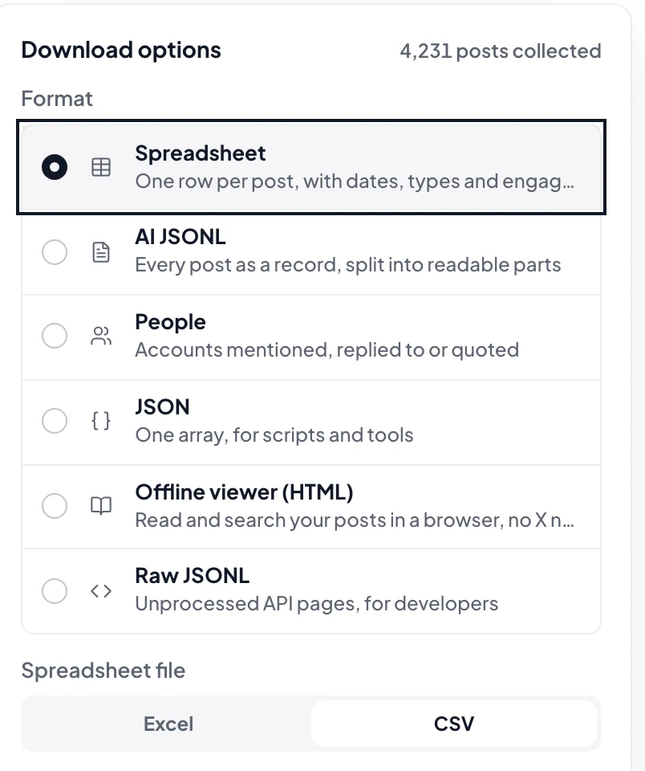

# Creel：把推特（X）书签、粉丝、推文和喜欢导出成 CSV、Excel 和 JSON

Creel 是一个 Chrome 扩展，在你自己的浏览器里把推特（X）的书签（含文件夹）、你的喜欢、某个账号的推文和回复、粉丝、关注和列表成员导出成 CSV、Excel 和 JSON 文件。不需要 X API 密钥，也不需要密码；每次导出 1,000 条以内免费，不需要注册 Creel 账号，只要在浏览器里登录 X。

[English](README.md) | 简体中文

这个仓库是 Creel 的公开文档和问题反馈区：每种导出包含哪些内容、示例文件、各项限制，以及报告问题的地方。Creel 不开源，这里没有源代码。


## 目录

- [安装](#安装)
- [每种数据怎么导出](#每种数据怎么导出)
- [能导出什么](#能导出什么)
- [文件格式](#文件格式)
- [每种导出的列](#每种导出的列)
- [数值怎么写](#数值怎么写)
- [示例文件](#示例文件)
- [免费版 Pro 和 Max](#免费版-pro-和-max)
- [Creel 不做什么](#creel-不做什么)
- [隐私](#隐私)
- [常见问题](#常见问题)
- [导出后的问题](#导出后的问题)
- [报告问题或提问](#报告问题或提问)
- [更新记录](#更新记录)

## 安装

- **Chrome：**[Chrome 应用商店里的 Creel](https://chromewebstore.google.com/detail/beildllmkhjnebibpaenchhkoalacgkk?utm_source=github&utm_medium=readme&utm_campaign=creel-repo-zh)，需要 Chrome 120 或更新版本。
- **Microsoft Edge：**2026-11-19 已提交到 Edge 加载项商店，2026-11-21 仍在审核中，暂时还没有 Edge 加载项商店的链接。
- **网站：**[ensoullab.com/extensions/creel](https://ensoullab.com/zh/extensions/creel)

用法：在同一个浏览器里登录 X，打开某个主页、你的书签、一个列表、一次搜索或一条推文，再点工具栏上的 Creel 按钮。Creel 会列出适合这个页面的导出，其余的在“All extractors”里。Chrome 开着时它在后台收集；扩展自带的“Download Manager”页面显示进度，文件也从那里保存。

## 每种数据怎么导出

下面每一条在 Creel 网站上都有一篇更详细的指南（英文），列出每一列并附示例文件。

### 怎么导出推特（X）书签？

在 x.com/i/bookmarks 打开你的书签，点 Creel。选全部书签；如果你的账号有文件夹，也可以只选一个文件夹。文件里一行是一条收藏的推文：正文、作者、时间、各项计数、图片和视频链接，以及这条推文所在的文件夹。可以存成 CSV、Excel 或 JSON。免费版每次导出 1,000 条，每个文件夹算一次单独的导出。Creel 只能读你自己的书签。书签没有每天或每周的自动更新；在一次完成的导出上点“Check for new bookmarks”会重新导出一次，任何套餐都能用，Max 还会算出新增了多少、删掉了多少。指南：[Export X (Twitter) bookmarks to CSV](https://ensoullab.com/zh/extensions/creel/export-x-bookmarks)。

### 怎么导出推特（X）的喜欢？

在任意 X 页面点 Creel，打开“All extractors”，在“Your library”下选“Likes”。导出的永远是你浏览器里登录的那个账号的喜欢。文件里一行是一条你喜欢过的推文，列和书签相同，只是没有文件夹列；可以存成 CSV、Excel、JSON，或不用 X 也能看的离线查看器。喜欢没有“Update”和“Auto update”；想要更新的喜欢，在 Download Manager 里这个导出的菜单中选“Duplicate as new export”。指南：[Export your X (Twitter) likes](https://ensoullab.com/zh/extensions/creel/export-x-likes)。

### 怎么导出一个推特（X）账号的粉丝列表？

打开这个主页（你自己的，或任何你看得到的账号），点 Creel，打开“All extractors”，在“This profile”下选“Followers”。文件里一行是一个账号：用户名、名称、简介、所在地、网站、粉丝数和关注数、认证标记，以及它是否关注了你。受保护账号的列表，只有你自己在 X 上打得开时才读得到。X 有时提前停止返回列表，所以文件的行数可能少于主页上的数字。想知道有什么变化：过一段时间在这个导出的菜单里选“Duplicate as new export”，再在新的那次上选“Compare with an earlier run”，任何套餐都能用；文件会列出只在其中一次出现的账号。只有完成的导出能对比，所以停在免费 1,000 条的名单要先买 Pro。Max 还可以每天或每周自动更新这个列表。指南：[Export X (Twitter) followers to CSV](https://ensoullab.com/zh/extensions/creel/export-x-followers)。

### 怎么导出一个推特（X）账号关注了谁？

打开这个主页，点 Creel，打开“All extractors”，在“This profile”下选“Following”。列和粉丝导出相同。对比同一个账号的两次完成的导出（“Compare with an earlier run”），会列出只在其中一次出现的账号，通常就是这段时间里它新关注和取关的人。指南：[Export an X (Twitter) following list](https://ensoullab.com/zh/extensions/creel/export-x-following)。

### 怎么导出一个推特（X）账号的全部推文？

打开这个主页，点 Creel，选“Export posts”，它包括回复。文件里一行是一条推文：正文、时间、类型（推文、回复、转推或引用）、各项计数和媒体链接。X 的主页时间线大约只到最新的 3,200 条；Pro 和 Max 可以用深度提取继续往前。只要带图片或视频的推文，在“All extractors”的“This profile”下选“Media posts”；用 Pro 或 Max，这种导出还能把图片和视频文件本身存下来。指南：[Export posts and replies from an X account](https://ensoullab.com/zh/extensions/creel/export-x-posts)。

### 怎么导出推特（X）列表的成员？

打开这个列表，点 Creel。在列表的“成员”标签页上，“List members”就在第一屏；在别的标签页上，它在“All extractors”的“This list”下。文件里一行是一个账号，列和粉丝导出相同。同一个列表里的推文也可以导出。列表成员不能对比，也没有“Update”和“Auto update”；想要新的一份，选“Duplicate as new export”。指南：[Export X (Twitter) list members](https://ensoullab.com/zh/extensions/creel/export-x-list-members)。

## 能导出什么

| 导出 | 从哪里开始 | 一行是 | 列 |
|---|---|---|---|
| 书签，全部或某个文件夹 | 你的书签页 | 一条推文 | [推文](#推文)，另加[书签文件夹列](#书签文件夹列) |
| 喜欢 | 任意 X 页面：All extractors，Your library | 一条推文 | [推文](#推文) |
| 某个账号的推文和回复 | 主页 | 一条推文 | [推文](#推文) |
| 某个账号带媒体的推文 | 主页：All extractors，This profile | 一条推文 | [推文](#推文) |
| 搜索结果 | 搜索页 | 一条推文 | [推文](#推文) |
| 列表里的推文 | 列表 | 一条推文 | [推文](#推文) |
| 一条推文的回复、引用 | 推文 | 一条推文 | [推文](#推文) |
| 一个串推（thread） | 推文 | 一条推文 | [推文](#推文)，另加[串推列](#串推列) |
| 粉丝、关注 | 主页：All extractors，This profile | 一个账号 | [账号](#账号) |
| 列表成员 | 列表 | 一个账号 | [账号](#账号) |
| 转推了某条推文的账号 | 推文 | 一个账号 | [账号](#账号) |
| 喜欢了某条推文的账号（和 X 一样，只限你自己的推文） | 你自己的推文 | 一个账号 | [账号](#账号) |
| 已屏蔽的账号、已隐藏的账号 | 已登录时，在支持的 X 页面打开弹窗 | 一个账号 | [账号](#账号)，另加 `unavailable` |
| 社群成员 | 社群 | 一个账号 | [社群成员](#社群成员) |
| 某个账号的文章 | 主页 | 一篇文章 | [文章](#文章) |
| 隐藏的字词 | 已登录时，在支持的 X 页面打开弹窗 | 一个字词 | [隐藏的字词](#隐藏的字词) |

除串推外，任何推文类导出都可以另存一份 **People** 文件：这些推文里出现的每个账号各占一行。见 [People](#people)。

两次完成的粉丝导出，或两次完成的关注导出，可以互相对比，任何套餐都能用。列表成员不能对比。见[账号](#账号)。

## 文件格式



| 格式 | 是什么 | 适用于 | 套餐 |
|---|---|---|---|
| CSV | 一张表，UTF-8 编码，带字节顺序标记（BOM）。导出全部书签时，也可以存成一个 ZIP，每个文件夹一份 CSV | 所有导出 | 免费 |
| Excel（`.xlsx`） | 同一张表，ID 按文本保存，时间是日期单元格，另有一个 About 工作表说明文件内容 | 所有导出 | 免费 |
| JSON | 同一张表，写成一个对象数组 | 所有导出 | 免费 |
| AI JSONL | 每行一条推文；Creel 有的话，附上它回复、引用或转推的那条推文。大的导出会分成几份 | 推文 | 免费 |
| Articles JSONL | 每行一篇文章，含正文 | 文章 | 免费 |
| 离线查看器（HTML） | 不上 X 也能在浏览器里阅读、搜索和筛选推文。2 万条以内是一个 HTML 文件；更大的导出，或包含已下载媒体的，是一个 ZIP。没有打包进去的图片在联网时从 X 加载 | 推文 | 免费 |
| 串推（Markdown） | 整个串推按阅读顺序写成一份文档 | 串推 | 免费 |
| Raw JSONL | Creel 保存的每一页占一行，带着 X 原样返回的内容，给开发者用 | 所有导出 | 免费 |
| Obsidian 笔记 | 一个 ZIP，每条推文一篇 Markdown 笔记（最多 6 万篇），外加一篇索引 | 推文 | Pro |
| Readwise 高亮 | 一份 CSV，格式符合 Readwise 的批量导入，每条推文一条高亮 | 推文 | Pro |
| 媒体文件夹、媒体 ZIP | 照片和视频文件本身 | 某个账号带媒体的推文 | Pro |
| AI 简报 | 一份 Markdown 简报加一段提示词，粘贴到你用的 AI 助手里。它是导出上的一个操作，不是下载格式 | 某个账号的推文和回复、带媒体的推文、串推、喜欢、书签、粉丝 | Pro |

CSV、Excel 和 JSON 是同一张表的三种写法：列相同、顺序相同、行也相同。完成的导出会留在 Download Manager 里，换一种格式再下载一次不需要重新从 X 收集。

## 每种导出的列

下面的名字就是 Creel 写进文件的列名。在 CSV 和 Excel 里，表示时间的列会在列名后加上 ` (UTC)`，例如 `created_at (UTC)`；JSON 的键名不加。

### 推文

书签、喜欢、主页推文、带媒体的推文、搜索结果、列表推文、回复、引用和串推都用这一组，共 42 列。

| 列 | 含义 |
|---|---|
| `tweet_url` | 这条推文在 X 上的链接。 |
| `id` | X 给这条推文的数字 ID。 |
| `created_at` | 发布时间，UTC。 |
| `author_id`、`author_username`、`author_display_name` | 作者的账号 ID、用户名和显示名称。 |
| `tweet_type` | `tweet`、`reply`、`retweet` 或 `quote`。 |
| `text` | 推文正文，长推文也是全文。转推写的是原推的正文。 |
| `lang` | X 给这条推文标的语言代码。 |
| `is_pinned` | X 把它标为主页置顶时为 `true`。 |
| `like_count`、`retweet_count`、`reply_count`、`quote_count`、`bookmark_count`、`view_count` | 收集这条推文时的各项数字。X 没给的数字留空。 |
| `stats_updated_at` | 读取这些数字的时间，UTC。 |
| `media_count` | Creel 收集到的附件数量，没有时为 `0`。 |
| `media_types` | 每个附件的类型：`photo`、`video` 或 `animated_gif`。 |
| `media_urls` | 每个附件一个链接：照片是图片本身，视频和 GIF 是封面图。 |
| `media_alt_texts` | 每个附件的替代文字，顺序相同，没有的位置留空。 |
| `video_url`、`video_duration_sec` | 第一个附件是视频或 GIF、且 X 提供了时，视频文件的链接和以秒计的长度。 |
| `thumbnail_url` | 第一个附件的图片。 |
| `link_url`、`link_title`、`link_domain` | 推文带的链接卡片（如果有）。 |
| `poll_options` | 投票的各个选项，X 给出票数时一并写上。 |
| `conversation_id` | 把推文归到同一段对话的 ID。 |
| `in_reply_to_id`、`in_reply_to_user_id`、`in_reply_to_username` | 它回复的那条推文和那个账号。 |
| `quoted_id`、`quoted_user_id`、`quoted_username`、`quoted_text` | 它引用的推文；Creel 有正文时一并写上。 |
| `retweeted_id`、`retweeted_user_id`、`retweeted_username` | 如果是转推，这里是原推。 |
| `text_truncated` | Creel 拿到的正文确知或看起来被截短时为 `true`。 |
| `deleted_status` | 留空，或 Creel 再次查看时发现的情况：`deleted`（已删除）、`original_deleted`（转推的原推已删除）、`retweet_undone`（转推已撤销）、`unavailable`（X 不再显示，但没说原因）。 |
| `deleted_detected_at` | Creel 发现上述情况的时间，UTC。 |

#### 书签文件夹列

书签导出在推文列之后多出三列。

| 列 | 含义 |
|---|---|
| `bookmark_folder_ids`、`bookmark_folder_names` | 你把这条推文放进的文件夹。一条推文可以在多个文件夹里。 |
| `bookmark_classification` | 在某个文件夹里是 `filed`；Creel 读完了所有文件夹而它不在任何一个里是 `unfiled`；其余情况是 `unknown`。 |

#### 串推列

串推导出在推文列之后多出三列。

| 列 | 含义 |
|---|---|
| `thread_position` | 这条推文在串推里的深度，从 1 开始。分支接着它分出来的那条推文往下数，所以要和 `thread_branch` 一起看。 |
| `thread_branch` | 主线是 `1`，分支依次是 `2`、`3`。 |
| `unavailable` | 推文已删除、账号被冻结或内容受限时为 `true`；保留这个占位行是为了不打乱顺序。 |

### 账号

粉丝、关注、列表成员，以及喜欢或转推了某条推文的账号都用这一组，共 24 列。

| 列 | 含义 |
|---|---|
| `id` | X 的数字账号 ID，改名后也不变。 |
| `profile_url`、`username`、`display_name` | 主页链接、用户名和显示名称。 |
| `description`、`location`、`website` | 主页上的简介、所在地和网址。 |
| `created_at` | 账号的注册时间，UTC。 |
| `followers_count`、`following_count`、`posts_count` | 收集这个账号时的各项数字。`posts_count` 在 X 提供时才有。 |
| `is_blue_verified` | 有蓝色认证标记时为 `true`。 |
| `verification_verified`、`verification_verified_type` | X 的另一个认证标记，以及 X 给出的认证类型（例如 `Business` 或 `Government`）。 |
| `affiliates_highlighted_label_type`、`affiliates_highlighted_label_url` | 主页上隶属标签的类型，以及它指向的链接。 |
| `privacy_protected` | 账号受保护（锁推）时为 `true`。 |
| `default_profile_image` | 账号使用 X 的默认头像时为 `true`。 |
| `avatar_image_url` | 头像的链接。 |
| `you_follow`、`follows_you` | 你是否关注它、它是否关注你。“你”指浏览器里登录的那个账号，导出别人的列表时也一样。 |
| `you_block`、`you_mute`、`you_can_dm` | 你是否屏蔽了它、隐藏了它，能否给它发私信。 |

已屏蔽和已隐藏的账号用同样的列，再多一列 `unavailable`：X 列出了这个账号、但 Creel 读不到它的详细信息时为 `true`，通常是被冻结或已停用的账号。

**对比两份名单。**任何套餐都可以对比两次完成的粉丝导出，或两次完成的关注导出。文件用同样的列，最前面多一列 `change`。同一个账号的两次导出给出 `added` 和 `removed`：谁新来了、谁离开了。两个不同的账号还会给出 `retained`：两份名单共有的账号。只有完成的导出能对比，所以停在 1,000 条的免费导出不能对比。

### 社群成员

共 11 列。

| 列 | 含义 |
|---|---|
| `id`、`profile_url`、`username`、`display_name` | 账号 ID、主页链接、用户名和显示名称。 |
| `role` | `Admin`、`Moderator` 或 `Member`。默认管理员在最前，其次是版主，然后是成员。 |
| `is_blue_verified`、`verification_verified` | 与[账号](#账号)里相同的认证标记。 |
| `privacy_protected` | 账号受保护时为 `true`。 |
| `avatar_image_url` | 头像的链接。 |
| `community_id`、`community_name` | 这份名单所属的社群。 |

### People

推文导出的 People 文件：收集到的推文的每位作者，以及这些推文提到、回复、引用或转推的每个账号各占一行，导出所属的那个账号除外。它用[账号](#账号)的列，并在 `display_name` 之后多出六列，共 30 列。

| 列 | 含义 |
|---|---|
| `relationship_types` | 这个账号以哪些方式出现：`mention`、`quote`、`reply`、`retweet` 中的一种或几种。只作为作者出现时为空。 |
| `reference_count` | 收集到的推文里，有多少条涉及这个账号。 |
| `mention_count`、`reply_count`、`quote_count`、`retweet_count` | 同样这些推文按方式分开计数。一条推文对一个账号只算一次，算在最强的那种方式下：转推优先于引用，引用优先于回复，回复优先于提到。 |

### 文章

共 17 列。

| 列 | 含义 |
|---|---|
| `article_url` | 文章在 X 上的链接。 |
| `article_id`、`tweet_id` | 文章的 ID，以及承载它的那条推文的 ID。 |
| `published_at` | 发表时间，UTC；X 没给发表时间时，用承载它的推文的时间。 |
| `author_id`、`author_username`、`author_display_name` | 作者的账号 ID、用户名和显示名称。 |
| `title`、`preview_text`、`body_text` | 标题、时间线上显示的摘要、X 提供时的正文。 |
| `cover_url` | 封面图的链接。 |
| `like_count`、`retweet_count`、`reply_count`、`quote_count`、`bookmark_count`、`view_count` | 收集这篇文章时的各项数字。 |

### 隐藏的字词

共 9 列。

| 列 | 含义 |
|---|---|
| `keyword` | 被隐藏的字词或短语。 |
| `muted_at`、`expires_at` | 隐藏的时间和到期的时间，UTC。永久隐藏时 `expires_at` 为空。 |
| `duration` | `Forever`、`24 hours`、`7 days`、`30 days`，其他时长则写到期时间。 |
| `home_timeline`、`replies`、`notifications` | 这条隐藏在哪些地方生效。 |
| `from` | `Anyone` 或 `People you don't follow`。 |
| `id` | X 给这个字词的 ID。 |

### Readwise 高亮（Pro）

给 Readwise 批量导入用的一份单独的 CSV，每条推文一行。它不带 BOM，也不加开头的撇号，因为 Readwise 会原样读取文字。

| 列 | 含义 |
|---|---|
| `Highlight` | 推文正文。转推用原推的正文；引用推文会把被引用的正文作为第二段附上；没有正文的推文用图片的替代文字，再没有就用推文链接。 |
| `Title` | `Posts from @用户名`，这样每位作者在 Readwise 里是一个来源。转推归在原作者名下。 |
| `Author` | 作者的显示名称，没有时用用户名。 |
| `URL` | 作者的主页链接。 |
| `Note` | 这条推文的链接。 |
| `Location` | 行号，从 1 开始。 |
| `Date` | 发布时间，UTC。 |

## 数值怎么写

**CSV**

- UTF-8 编码并带 BOM，这样 Excel 打开时表情符号和中日韩文字不会乱码。
- 时间是 UTC，写成 `YYYY-MM-DD HH:mm:ss`。
- 是和否写成 `true` 和 `false`，未知的值留空。
- `media_types` 和 `media_urls` 里的多项用 `; ` 分隔；People 文件里的 `relationship_types` 也是。
- `media_alt_texts`、`poll_options`、`bookmark_folder_ids` 和 `bookmark_folder_names` 是 JSON 列表，例如 `["Design","Reading list"]`。空列表写成空单元格。
- 以 `=`、`+`、`-`、`@`、制表符或回车开头的单元格前面会加一个撇号（`'`）。表格软件会把这样的单元格当成公式，加上撇号它就只是文字。最常见的是以 @ 开头的回复。脚本如果需要一字不差的原文，请读 JSON 文件，JSON 从不加撇号。
- ID 写的是完整的数字。Excel 直接打开 CSV 时会把长数字显示成科学计数法并把末几位变成 0，所以请下载 Excel 文件，或者导入 CSV 时把 ID 列设成文本。见[导出后的问题](#导出后的问题)。

**Excel**

- 所有 ID 列都按文本保存，不会被四舍五入。
- 时间是真正的日期单元格，UTC。
- 不加开头的撇号。
- 超过 Excel 单元格长度上限的内容会被截短并做标记，About 工作表会写明有多少个单元格被截短。
- About 工作表列出导出的名称、内容、来源、导出时间、行数和 Creel 版本，推文类导出还有时间范围；书签导出另写文件夹信息是否完整。

**JSON**

- 一个数组，每行一个对象，键的顺序就是列的顺序。
- ID 是字符串，计数是数值，是和否是 `true` 和 `false`。
- 时间是 UTC 的 ISO 8601 格式，例如 `2026-11-18T09:12:00Z`。
- 列表类的列是数组，缺失的值是 `null`。
- 不带 BOM，也不加撇号。

**文件名**

文件按导出类型、来源（账号、搜索、列表、文件夹）和下载当天的日期命名，例如 `bookmarks-yourhandle-2026-11-19.csv`，保存在 Chrome 的下载文件夹里。

## 示例文件

[`samples`](samples) 文件夹里是几个小文件，由 Creel 自己的 CSV 和 JSON 写入代码用虚构数据生成。表头、列的顺序和数值的写法与真实导出完全一致；账号、推文和 ID 都是编的。这些 ID 超出了 X 发过的任何 ID，所以示例里的链接不会打开真实的推文。媒体和网址链接指向 example.com；在真实导出里，媒体链接指向 X 的媒体服务器，网址保留原来的地址。

| 文件 | 展示什么 |
|---|---|
| [`samples/bookmarks.csv`](samples/bookmarks.csv) | 一次书签导出：45 列，有照片、视频、链接卡片、投票、引用、文件夹，还有一条开头被加了撇号的回复。 |
| [`samples/bookmarks.json`](samples/bookmarks.json) | 同样的行，JSON 格式。 |
| [`samples/posts.csv`](samples/posts.csv) | 某个账号的推文和回复：一条置顶、一条引用、一条回复、一条转推和一条带照片的推文。 |
| [`samples/followers.csv`](samples/followers.csv) | 一次粉丝导出：24 列，有一个受保护的账号、一个认证账号和一个使用默认头像的账号。 |
| [`samples/followers.json`](samples/followers.json) | 同样的行，JSON 格式。 |

`samples/followers.csv` 的前两行：

```csv
id,profile_url,username,display_name,description,location,website,created_at (UTC),followers_count,following_count,posts_count,is_blue_verified,verification_verified,verification_verified_type,affiliates_highlighted_label_type,affiliates_highlighted_label_url,privacy_protected,default_profile_image,avatar_image_url,you_follow,follows_you,you_block,you_mute,you_can_dm
7440063965393846272,https://x.com/example_design,example_design,Example Designer,"Product designer. Notes on onboarding, forms and small screens.",Lisbon,https://example.com/designer,2014-03-02 10:00:00,18420,913,6431,true,false,,,,false,false,https://example.com/avatars/example_design.jpg,true,true,false,false,true
```

## 免费版 Pro 和 Max

| | 免费版 | Pro | Max |
|---|---|---|---|
| 价格 | 0 美元，无需 Creel 账号 | 19.99 美元，一次性 | 29.99 美元，一次性（从 Pro 升级 10 美元） |
| 每次导出的条数 | 最多 1,000 条 | Creel 不设上限 | Creel 不设上限 |
| 所有导出的 CSV、Excel、JSON | 有 | 有 | 有 |
| AI JSONL、离线查看器、People 文件、对比两次粉丝或关注导出 | 有 | 有 | 有 |
| 某个账号的推文和回复里，X 只显示的约 3,200 条之前的部分 | 没有 | 有 | 有 |
| 覆盖检查：查找“推文和回复”导出里的缺口并尽量补齐 | 没有 | 有 | 有 |
| 照片和视频文件，来自媒体推文导出 | 没有 | 有 | 有 |
| Obsidian 笔记、Readwise 高亮 | 没有 | 有 | 有 |
| AI 简报和现成的提示词 | 没有 | 有 | 有 |
| Social circle：一个账号常回复、引用、转推和提到谁 | 前 10 位 | 导出里的所有人 | 所有人，最多 1,000 人的关系图，两个圈子对比 |
| 已保存的主页或搜索只取新增内容来更新 | 没有 | 没有 | 有 |
| Chrome 开着时每天或每周自动更新：主页、搜索、粉丝和关注名单、串推 | 没有 | 没有 | 有 |

Pro 和 Max 都是一次性购买，不是订阅。在 [ensoullab.com](https://ensoullab.com/zh/extensions/creel) 购买，授权绑定在 Ensoul Lab 账号上。如果 Creel 在你的账号上用不了，购买后 7 天内可以申请退款。

免费额度怎么算：按每次导出算，不按天，也不按账号。免费导出从 X 列表的最上面开始，到 1,000 条（推文、账号、文章或字词）时停下，已保存的部分可以用任何免费格式下载。每个书签文件夹是一次单独的导出，各有 1,000 条。复制一份免费导出（“Duplicate as new export”）会从最上面重新开始，不会接着取后面的 1,000 条。想继续，买 Pro 后在停下的那个导出上点“Resume”：已保存的部分保留，从停下的地方接着收集。

## Creel 不做什么

- **只能看到你的 X 账号能看到的内容。**Creel 以浏览器里登录的账号读取 X。你自己在 X 上打不开的受保护账号、别人的书签，以及 X 不给你看的任何东西，它都读不到。和 X 一样，喜欢了某条推文的名单只能看你自己的推文。
- **不会超出 X 返回的范围。**主页时间线大约只到最新的 3,200 条。Pro 和 Max 用深度提取继续往前取，免费版不行。有些账号的书签，X 还没到最早的一条就不再返回；粉丝列表也可能比主页上的数字短。X 在哪里停，Creel 就在哪里停。
- **免费版每次导出到 1,000 条为止。**想让每条书签都带文件夹标签，请一个文件夹一个文件夹地导出，每个文件夹各有 1,000 条。
- **表格和 JSON 里是图片和视频的链接，不是文件本身。**链接指向 X 的服务器，X 还保留这些文件时才打得开。保存照片和视频文件是 Pro 功能，只能从某个账号的媒体推文导出里存，书签和喜欢不行。
- **数字是当时的快照。**喜欢数、浏览量等都是收集那一刻的数值。
- **Chrome 必须开着。**导出和定时更新都在你的浏览器里运行，不在服务器上。大的导出需要时间，因为 X 限制每个账号读取的速度。导出暂停时，Download Manager 里它的卡片会写明原因和何时继续。
- **不导出私信。**
- **不发推、不关注、不点赞、不删除任何东西。**Creel 只读取。
- **界面是英文的。**商店页面有多种语言，扩展本身没有翻译。
- **没有 Firefox 或 Safari 版本。**
- **与 X Corp. 没有关联。**X 随时可能改动网站，某种导出可能因此失效，直到 Creel 更新。遇到这种情况，请[告诉我们](#报告问题或提问)。

## 隐私

留在你浏览器里的：

- Creel 收集的一切：推文、账号、书签、列表，以及由它们生成的文件。它们保存在浏览器里扩展自己的存储空间，下载时写到你的电脑上。
- 你的 X 登录状态。Creel 使用浏览器里已经登录的会话，从不索要你的 X 密码。
- 使用计数，例如你做了多少次导出、用到了哪些功能，扩展用它来显示套餐的限制。这些只留在你的设备上。

会离开你浏览器的：

- **发给 X 的请求。**Creel 向 X 自己的服务器要数据，和 X 网站用的是同一批服务器；查看或下载图片和媒体时，也会从 X 的媒体服务器加载。
- **来自 ensoullab.com 的公开状态通知。**Creel 不时读取一个很小的公开文件，用来显示服务通知。这个请求不带你收集的任何内容，也不带账号信息。
- **Ensoul Lab 网站可以询问 Creel 是否已安装。**你打开 ensoullab.com 时，网站可以询问扩展，扩展回答它的版本号，别的都不发。
- **授权检查，仅当你连接了 Ensoul Lab 账号。**Creel 把这个账号的令牌发到 ensoullab.com 读取你的套餐：不时检查一次、你手动检查时，以及退出登录时。其中不含任何 X 数据。

Creel 没有统计分析或跟踪服务；你收集的内容不会发给 Ensoul Lab，也不会发给任何人。完整的隐私政策见 [ensoullab.com/privacy](https://ensoullab.com/privacy)。

扩展申请的权限和原因：

| 权限 | 原因 |
|---|---|
| `storage` | 保存设置和可选的 Ensoul Lab 账号。收集到的记录存在浏览器里扩展自己的数据库中。 |
| `cookies` | 读取 X 的登录 Cookie：确认登录的是哪个账号、向 X 发请求，并在账号切换时暂停导出。这些值只用于发往 X 的请求。 |
| `declarativeNetRequest` | 让 Creel 在后台发出的请求像 X 网站自己的请求一样到达 X。只对 X 的域名生效，不改动你打开的页面。 |
| `activeTab`、`scripting` | 你点工具栏按钮时，读取当前打开的是哪个 X 页面，以及页面上显示的主页名称、头像和数字，以便给出合适的导出。 |
| `downloads` | 把导出文件和媒体保存到下载文件夹。 |
| `alarms` | 让导出持续运行、继续被暂停的导出，运行你开启的定时更新，刷新状态通知和可选的授权，并清理旧的本地数据。 |
| `notifications` | 长时间的导出完成或需要你处理时、定时更新发现新内容时通知你。每一类都可以在设置里关掉。 |
| 网站：`x.com`、`api.x.com`、`abs.twimg.com`、`ton.x.com` | X 自己的页面和服务器：数据从这里来，Creel 也从这里读取发请求所需的 X 网页应用文件。 |

## 常见问题

### Creel 免费吗？

免费，每次导出 1,000 条以内，不需要 Creel 账号，也没有试用期。每种导出都可以免费存成 CSV、Excel 和 JSON。Pro（19.99 美元）和 Max（29.99 美元）都是一次性购买，去掉条数限制，并加上[免费版 Pro 和 Max](#免费版-pro-和-max)里列的功能。

### 需要 X API 密钥、开发者账号或 X 密码吗？

不需要。Creel 在 Chrome 里运行，通过你浏览器里已经登录的账号读取 X。Creel 不会要求你输入 X 密码，也没有 API 密钥要设置。

### 导出的数据会上传到别处吗？

不会。文件在你的浏览器里生成，由你保存到自己的电脑。Creel 会发出哪些请求、发给谁，写在[隐私](#隐私)一节。

### 一个账号能导出超过 3,200 条推文吗？

能，需要 Pro 或 Max。X 的主页时间线大约到最新的 3,200 条为止。某个账号的推文和回复，Pro 和 Max 用深度提取继续往前。免费版每次导出到 1,000 条为止。

### 账号被锁或被封之前，能先备份我的 X 数据吗？

Creel 只能保存你登录的账号当时在 X 上打得开的内容，所以要趁一切还能正常打开时导出想留下的东西。书签、喜欢、推文、粉丝和关注都能各自存成文件留着。想要整个账号的官方副本，X 自己也可以在账号设置里下载你的数据存档。

### 能导出别人的书签或喜欢吗？

不能。Creel 只能导出你浏览器里登录的那个账号的书签和喜欢，X 只把它们显示给你本人。别人的推文、粉丝、关注和列表，只要 X 显示给你，都可以导出。

### Creel 能在 Edge、Firefox、Safari 或手机上用吗？

需要电脑上的 Chrome 120 或更新版本。Edge 版本在审核中。没有 Firefox 和 Safari 版本，手机上的 Chrome 也不能运行扩展。

### Creel 开源吗？

不开源。这个仓库放的是它的文档、示例文件和问题反馈区，没有代码。

## 导出后的问题

解答在 Creel 网站上（英文），每个问题有自己的链接。

书签导出之后：

- [CSV 在 Excel 里为什么是乱码？](https://ensoullab.com/zh/extensions/creel/export-x-bookmarks#excel-garbled-text)
- [推文 ID 在 Excel 里为什么变成 1.23E+18 或末尾全是 0？](https://ensoullab.com/zh/extensions/creel/export-x-bookmarks#excel-long-ids)
- [CSV 里有些单元格为什么以撇号开头？](https://ensoullab.com/zh/extensions/creel/export-x-bookmarks#leading-apostrophe)
- [导出的书签为什么比我收藏的少？](https://ensoullab.com/zh/extensions/creel/export-x-bookmarks#fewer-bookmarks)
- [导出为什么暂停了，会自己继续吗？](https://ensoullab.com/zh/extensions/creel/export-x-bookmarks#export-paused)
- [导出的文件存到哪里了？](https://ensoullab.com/zh/extensions/creel/export-x-bookmarks#where-is-the-file)
- [书签文件夹那几列为什么是空的？](https://ensoullab.com/zh/extensions/creel/export-x-bookmarks#folder-columns-empty)
- [我的书签会被上传到哪里吗？](https://ensoullab.com/zh/extensions/creel/export-x-bookmarks#data-privacy)
- [1,000 条的免费额度对书签怎么算？](https://ensoullab.com/zh/extensions/creel/export-x-bookmarks#free-limit)

粉丝或关注导出之后：

- [CSV 在 Excel 里为什么是乱码？](https://ensoullab.com/zh/extensions/creel/export-x-followers#excel-garbled-text)
- [账号 ID 在 Excel 里为什么变成 1.23E+18 或末尾全是 0？](https://ensoullab.com/zh/extensions/creel/export-x-followers#excel-long-ids)
- [CSV 里有些单元格为什么以撇号开头？](https://ensoullab.com/zh/extensions/creel/export-x-followers#leading-apostrophe)
- [文件的行数为什么比主页上的粉丝数少？](https://ensoullab.com/zh/extensions/creel/export-x-followers#fewer-followers)
- [导出为什么暂停了，会自己继续吗？](https://ensoullab.com/zh/extensions/creel/export-x-followers#export-paused)
- [导出的文件存到哪里了？](https://ensoullab.com/zh/extensions/creel/export-x-followers#where-is-the-file)
- [能导出受保护账号的粉丝吗？](https://ensoullab.com/zh/extensions/creel/export-x-followers#protected-accounts)
- [粉丝列表会被上传到哪里吗？](https://ensoullab.com/zh/extensions/creel/export-x-followers#data-privacy)
- [1,000 条的免费额度对粉丝列表怎么算？](https://ensoullab.com/zh/extensions/creel/export-x-followers#free-limit)

## 报告问题或提问

- **遇到 bug：**[提交 bug 报告](../../issues/new?template=bug-report.yml)。表单会问导出类型、浏览器版本，以及导出卡片上显示了什么。
- **有疑问：**[在这里提问](../../issues/new?template=question.yml)，或者到 [Ensoul Lab 的 Discord](https://ensoullab.com/discord)。
- **购买、退款或账号相关的事：**请发邮件到 support@ensoullab.com，不要把订单信息写在公开的 issue 里。

Issue 是公开的。请不要粘贴 Cookie、令牌、密码、授权信息，也不要上传含有他人数据的导出文件。一张导出卡片的截图，加上几句你原本期望的结果，通常就够了。

## 更新记录

在 Chrome 应用商店公开上架过的版本。从 0.2.4 起，更新说明也会发在 [Ensoul Lab 的 Discord](https://ensoullab.com/discord)。

**0.2.5**（2026 年 11 月）

- X 改版后无法开始的导出，现在可以正常开始了。
- 被 X 的错误打断的导出，不再看起来像已经完成。

**0.2.4**（2026-11-18）

- 没有 X Premium 的账号第一次导出书签时不再出现文件夹错误。
- 导出读完所有文件夹后，不在任何文件夹里的书签会标为 unfiled。
- 搜索和引用导出不再在收集完所有结果之前停下。
- X 返回的错误会如实显示为错误，不再让导出看起来像已完成。
- Discord 按钮会打开当前有效的邀请链接。

**0.2.1**（2026-10-20）

- 商店页面新增日文、简体中文、繁体中文、西班牙文和巴西葡萄牙文。

**0.2.0**（2026-10-16）

- Creel 在 Chrome 应用商店公开上架。

---

Creel 由 [Ensoul Lab](https://ensoullab.com) 制作，与 X Corp. 没有关联。“X”和“Twitter”是 X Corp. 的商标。

本仓库的文字和示例文件版权归 Ensoul Lab 所有。Creel 扩展是专有软件，本仓库不授予它的任何许可。
